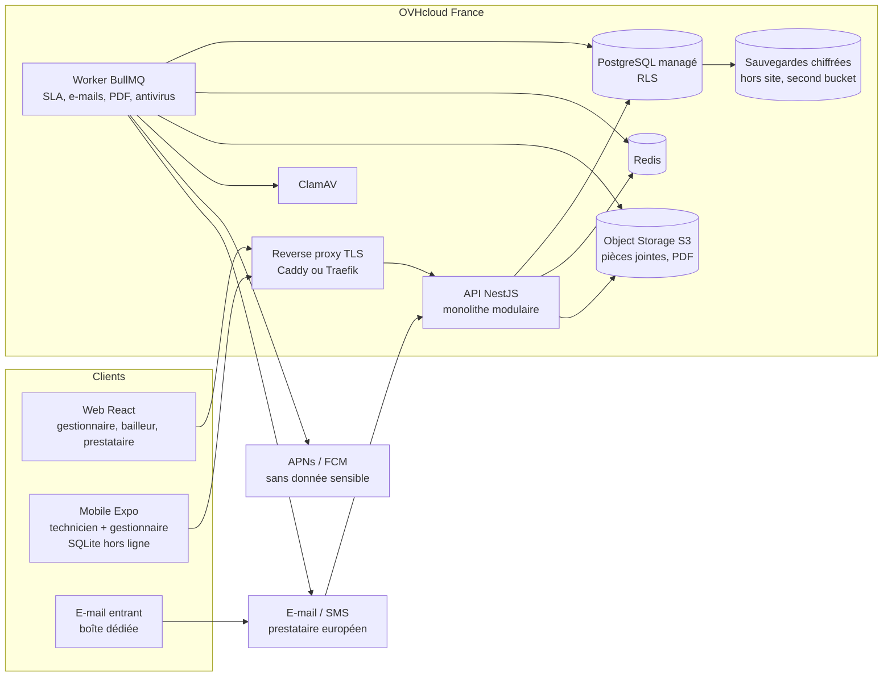

# 01 — Architecture

## Choix de conception
Monolithe modulaire NestJS (TypeScript), PostgreSQL managé avec RLS, Redis + BullMQ, stockage S3 OVH, web React (Vite), mobile Expo (React Native, SQLite). Monorepo pnpm. Les alternatives écartées sont dans [DECISIONS.md](../DECISIONS.md).

## Modules du monolithe
`identity` (comptes, MFA, appartenances), `tenancy` (organisations, contrats, partages, sous-traitance), `patrimoine`, `actifs`, `ticketing`, `workorders`, `sla`, `routing`, `messaging` (fils), `files`, `notifications`, `reporting`, `audit`, `sync` (mobile), `config` (3 niveaux).

Règle : un module n'accède aux tables d'un autre que via son service exposé. Vérifiée par un test d'architecture (dependency-cruiser) en CI.

## Accès aux données (point critique)
1. Chaque requête s'exécute dans une transaction.
2. Un intercepteur pose `SET LOCAL app.user_id`, `app.org_id` (espace de travail actif) et `app.role_scope` avant tout accès.
3. L'application se connecte avec un rôle SQL **sans** `BYPASSRLS` et **non propriétaire** des tables (`FORCE ROW LEVEL SECURITY`).
4. Les migrations et les jobs d'administration utilisent un autre rôle, jamais exposé aux requêtes utilisateurs.
5. Compatible avec un pool en mode transaction (PgBouncer), car `SET LOCAL` est borné à la transaction.

Détails dans [03-rls-et-visibilite.md](03-rls-et-visibilite.md).

## Hors ligne mobile
- Base locale SQLite, **une base chiffrée par couple (utilisateur, organisation)** ; changement d'espace = bascule de base, déconnexion = suppression.
- Lecture : `GET /sync/pull?cursor=` renvoie les changements depuis le curseur (table `changelog` côté serveur, filtrée par RLS).
- Écriture : file d'actions locales `{action_id (UUID client), type, payload, base_version}` envoyée par `POST /sync/push`. L'`action_id` rend le rejeu idempotent.
- Conflits : champs libres en « dernier écrit gagne » avec trace ; **transitions de statut rejouées côté serveur** et refusées si invalides (le client reçoit l'état serveur et la raison).
- Pièces jointes : envoi différé par URL pré-signée, reprise sur coupure.
- Risque : c'est le module le plus difficile. Prototype dès l'incrément 5, avant de bâtir dessus.

## Environnements et exploitation
- dev (Docker Compose local), staging et prod (OVH). Infrastructure décrite en Terraform. Déploiement par GitHub Actions : build image, migrations versionnées, déploiement, vérification de santé.
- Feature flags : table `feature_flag` par organisation (pas de service tiers).
- Observabilité : logs JSON (pino), métriques Prometheus, alertes. Hébergement de la pile d'observabilité à trancher (Grafana auto-hébergé en France, pas de SaaS hors UE).
- Dépendances hors France documentées : APNs / FCM (push sans donnée sensible). Expo EAS : à éviter pour la chaîne de build (builds en CI), à confirmer.

## Chiffrement
En transit : TLS partout. Au repos : disque et sauvegardes chiffrés côté OVH ; **chiffrement des sauvegardes hors site avec une clé qui nous appartient** (à implémenter, non supposé fourni).
