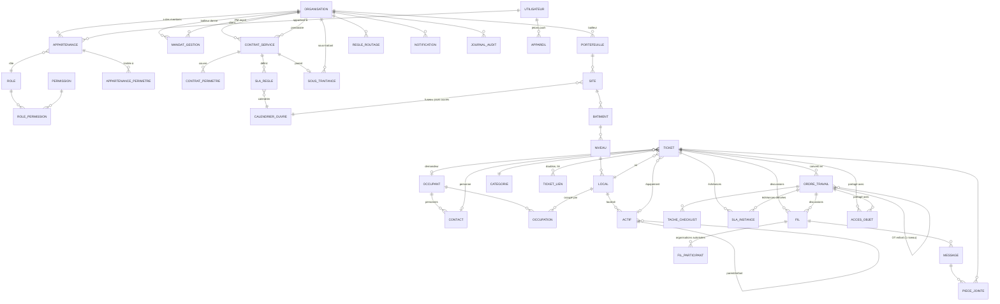

# 02 — Modèle de données (ERD) et index clés

## Choix de conception
- PostgreSQL, clés `uuid` (v7, triables par date), `org_id` sur toute table métier, horodatages `timestamptz` en UTC, suppression logique (`deleted_at`) pour la corbeille.
- Le **bailleur et le property manager sont des `organisation`** (champ `type`). Le propriétaire historique d'une donnée est le bailleur (réversibilité : l'historique lui reste).
- Un PM agit pour un bailleur via un **`mandat_gestion`** daté (périmètre : portefeuille ou sites). Changer de PM = clore un mandat, en ouvrir un autre, sans toucher aux données.
- **Occupation multi-sites, multi-immeubles, multi-occupants** : un local peut avoir plusieurs occupants simultanés (partage de plateau) et successifs. L'occupant est une entité (société ou particulier) avec plusieurs contacts, reliée aux locaux par une occupation datée.

## Entités ajoutées par rapport au cahier des charges
`mandat_gestion`, `occupant`, `contact`, `occupation`, `fil` + `fil_participant` (porte toute la visibilité des discussions), `acces_objet` (partage inter-organisations), `ticket_lien`, `changelog` (synchronisation mobile), `appareil`, `support_grant` (accès support éditeur borné et tracé), `feature_flag`, `config_version`.

## Précisions de modèle
- **Occupation** : `occupation(id, org_id, occupant_id, local_id, debut, fin NULL, type, surface_m2 NULL)`. Un local à plusieurs occupants = plusieurs lignes actives. L'occupant « actuel » d'un local est calculé, jamais stocké sur le local.
- **Ticket** : rattaché à un `local` (obligatoire) ; site, bâtiment, niveau sont dérivés par jointure et dénormalisés (`site_id`) pour les droits et les index. `occupant_id` et `contact_id` sont facultatifs (partie commune, incident technique sans demandeur).
- **Parties communes** : local de type `partie_commune` (hall, toiture, parking), sans occupation.
- **Ticket multi-locaux** (fuite touchant plusieurs étages) : ticket principal + `ticket_lien` de type `lié`, plutôt qu'un many-to-many (simplifie SLA et OT).
- **OT enfant** : `parent_ot_id` ; un `CHECK` et un trigger refusent un OT dont le parent a lui-même un parent (1 niveau max) et tout cycle.
- **Finance** (V2) : `ot_financier` séparé de `ordre_travail`, pour masquer prix et marges par table et non par colonne.

## Index clés
| Table | Index | Usage |
|---|---|---|
| toutes | `(org_id, id)` | RLS + clés étrangères |
| `ticket` | `(owner_org_id, statut, created_at DESC)` ; `(site_id, statut)` ; `(local_id)` ; GIN `to_tsvector('french', titre \|\| ' ' \|\| description)` | liste, backlog, recherche |
| `acces_objet` | `(org_id, objet_type, objet_id)` **et** `(objet_type, objet_id)` | sous-requête RLS, déterminante pour la performance |
| `sla_instance` | `(echeance_at) WHERE etat IN ('en_cours','alerte')` | balayage des échéances |
| `ordre_travail` | `(assigned_org_id, statut)` ; `(parent_ot_id)` | file prestataire, sous-traitance |
| `message` | `(fil_id, created_at)` | fil de discussion |
| `occupation` | `(local_id) WHERE fin IS NULL` ; `(occupant_id)` | occupants actuels |
| `actif` | `(local_id)` ; `(parent_id)` ; `(org_id, qr_code)` UNIQUE | fiche, scan QR |
| `local` | `(niveau_id)` ; `(org_id, qr_code)` UNIQUE | hiérarchie, scan QR |
| `changelog` | `(org_id, seq)` | curseur de synchronisation |
| `journal_audit` | `(org_id, created_at)` ; `(objet_type, objet_id)` | audit, partitionné par mois |
| `appartenance` | `(utilisateur_id)` ; `(org_id, role_id)` | sélecteur d'espace, droits |

## Volumétrie (à valider par test de charge)
Cible : 1 M de tickets, 100 000 actifs. Les tables `ticket`, `message`, `journal_audit`, `changelog` sont candidates au partitionnement par date si les tests de charge l'exigent ; `journal_audit` est partitionné dès le départ.
