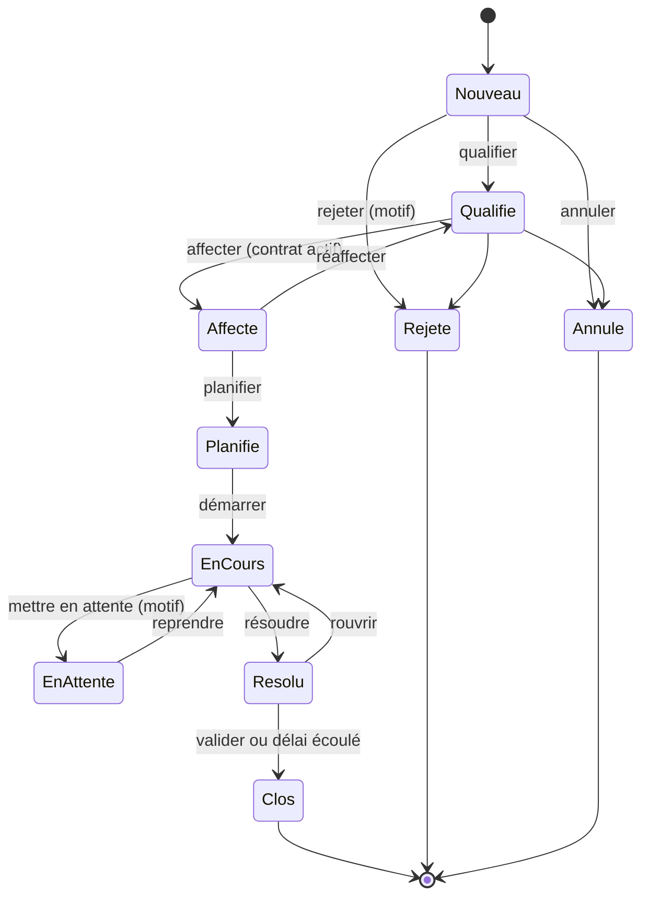
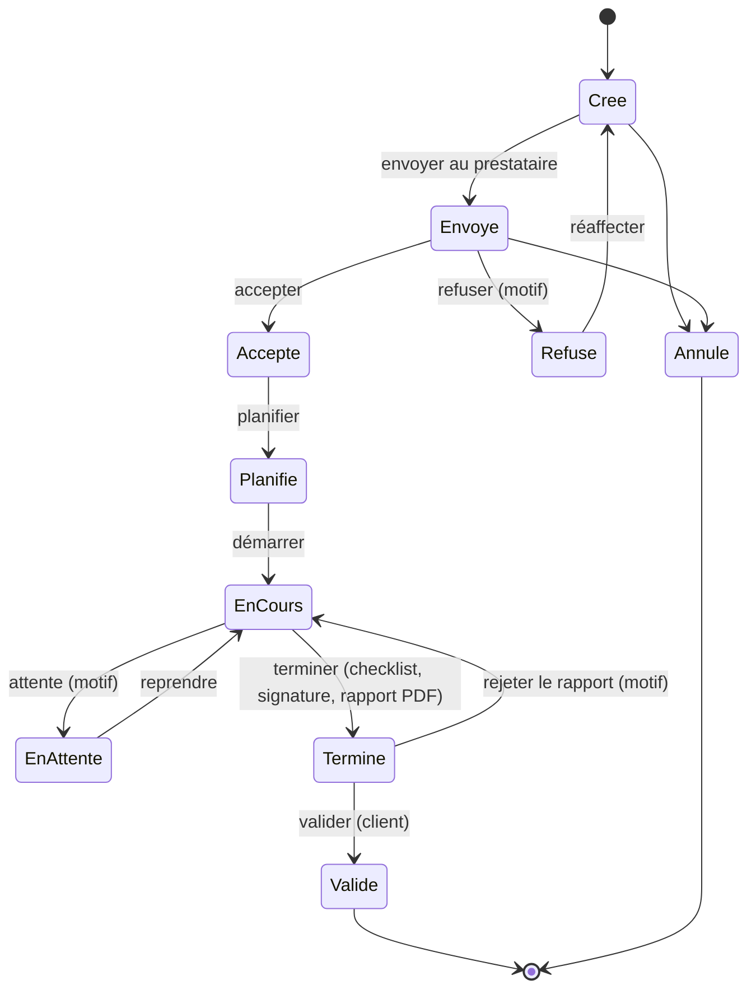

# 05 — Machines à états

Les statuts sont configurables par client (niveau 3 de configuration). Ce document décrit le **défaut**. Chaque transition est journalisée (qui, quand, depuis, vers, motif).

## Ticket

| Transition | Qui | Garde |
|---|---|---|
| Nouveau → Qualifié | gestionnaire FM, responsable de site | catégorie et priorité renseignées |
| Qualifié → Affecté | gestionnaire FM | contrat actif couvrant site + lot ; documents prestataire valides |
| Affecté → Planifié | prestataire (technicien ou dispatcheur) | date prévue |
| Planifié → En cours | technicien | — |
| En cours ⇄ En attente | technicien, prestataire, gestionnaire | motif obligatoire : pièce, accès, validation, tiers |
| En cours → Résolu | technicien, prestataire | rapport d'intervention présent si OT |
| Résolu → Clos | gestionnaire (ou clôture automatique après N jours, configurable) | satisfaction saisie facultative |
| Résolu → En cours (réouverture) | gestionnaire | motif ; compte dans la récurrence |
| → Rejeté / Annulé | gestionnaire FM, responsable de site | motif ; interdit après « En cours » sauf admin |

**Réaffectation** : retour à « Qualifié » avec révocation des accès du prestataire précédent (`acces_objet.revoque_at`), tracée ; l'historique du ticket reste lisible par le client.

**Pause SLA** : les motifs d'attente marqués `pause_sla = vrai` dans la configuration (voir [06](06-sla.md)).

## Ordre de travail

### Sous-traitance (1 niveau, unidirectionnelle)
- Le prestataire principal crée un **OT enfant** (`parent_ot_id`) pour un sous-traitant ayant une `sous_traitance` active avec lui.
- L'OT enfant suit la même machine à états. Son « Validé » est prononcé par le **prestataire principal** ; le client ne voit jamais l'OT enfant.
- L'OT parent ne peut passer à « Terminé » que si tous ses OT enfants sont « Validé » ou « Annulé ».
- Un sous-traitant ne peut pas créer d'OT enfant (contrainte de base : `parent_ot_id` d'un OT enfant doit désigner un OT sans parent).
- Le sous-traitant voit : l'OT, le site/local, l'actif, les consignes. Il ne voit ni prix, ni contrat parent, ni ticket d'origine.

## Implémentation
Machine à états en code (table de transitions déclarative, une seule source), appliquée dans le service du module. Les transitions reçues du mobile sont **rejouées** côté serveur. Un test génère toutes les paires (état, transition) et vérifie que seules les transitions du tableau passent.
